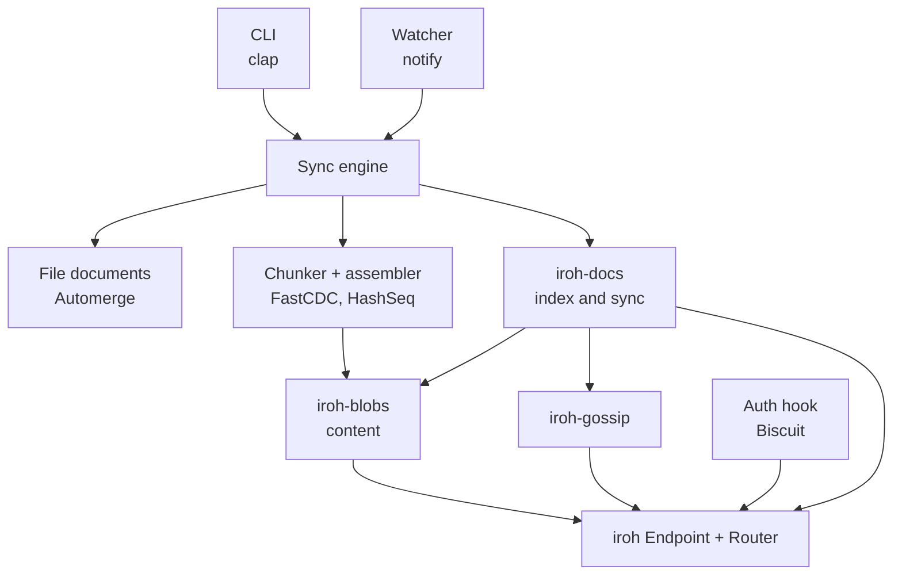

# SPEC2: Folder sync on iroh, iroh-docs and Automerge

Date: 2026-09-21. Crate versions were checked against docs.rs on that date.

> This document is the second design and the one this repository implements.
> Where it says "SPEC.md" it refers to an earlier design that built the wire
> protocol, storage, signaling and fetching by hand; that document is not part
> of this repository, and section 11 summarizes how the two differ.

## 0. Summary

SPEC.md built the wire protocol, storage, gossip signaling, chunk fetching and version tracking by hand. SPEC2 reuses the iroh 1.x stack for all of that. The custom code shrinks to five small pieces:

1. **File documents:** one Automerge document per file path, which supplies causal history and conflict detection.
2. **Chunker and assembler:** FastCDC chunks stored as iroh-blobs, with a `HashSeq` as the manifest, so a changed file transfers only its new chunks.
3. **Sync engine:** a file watcher plus a materializer that connects the folder to the vault.
4. **Admission:** Biscuit capability tokens enforced by an iroh endpoint hook, adapted from n0's own `auth-hook` example.
5. **CLI:** `init`, `invite`, `join`, `run`, `status`.

Everything else, meaning encrypted transport, NAT traversal, index reconciliation, catch-up after being offline, verified content transfer, multi-source download and persistence, comes from `iroh`, `iroh-docs`, `iroh-blobs` and `iroh-gossip`.

## 1. Goals and scope

### Goals

- Sync a folder between devices with no central server.
- Transfer only changed fragments of a file, and pull them from several peers in parallel.
- Admit peers with signed, expiring, endpoint-bound capability tokens instead of accounts.
- Treat divergence as normal: concurrent edits are detected and settled by rule, and no edit is silently lost.

### Non-goals (PoC)

- End-to-end encryption beyond transport encryption, encryption at rest, and edge or IoT footprint targets.
- More than one vault per process, per-file access control, and token revocation before expiry.
- Vaults with hundreds of thousands of files.
- Production use. iroh-blobs 0.103 describes itself as not yet production quality (section 3).

### Success criteria

1. Three nodes: A adds a 10 MiB binary file; B and C receive a byte-identical copy.
2. A one-byte edit in the middle of that file makes B and C download at most 3 new chunks plus the new manifest and file document.
3. A peer without a valid token cannot open a docs, blobs or gossip connection. Expired tokens and tokens presented from the wrong endpoint are refused.
4. Partitioned concurrent edits to one text file merge without loss. Partitioned concurrent edits to one binary file give the same visible winner on every peer, keep the loser retrievable, and flag the file until the next write resolves it.
5. A peer that was offline catches up after reconnecting, and deletions propagate.
6. The four quality gates in section 8 pass at every commit.

## 2. Reuse map

| Need | Provided by | Custom code |
| --- | --- | --- |
| Encrypted peer-to-peer connections, NAT traversal, relays, address lookup | `iroh` | None |
| Multiplexing several protocols on one endpoint | iroh `Router` | None |
| Which files and versions exist, live updates, catch-up after offline | `iroh-docs` (range-based set reconciliation) with `iroh-gossip` | None |
| Content transfer with verified streaming, resume, multi-provider download | `iroh-blobs` | None |
| Persistence of blobs and of the index | `iroh-blobs` `FsStore`, `iroh-docs` persistent store | None |
| Vault identity, invites, read versus write capability | `iroh-docs` namespace key and `DocTicket` | None |
| Causal history, text merging, conflict detection | Automerge | Schema and glue |
| Delta transfer of changed fragments | FastCDC plus `HashSeq` manifests in `iroh-blobs` | Chunker and assembler |
| Capability admission with audience, expiry and delegation | Biscuit plus iroh `EndpointHooks` | Auth module |
| File watching and debounce | `notify`, `notify-debouncer-full` | Glue |
| Folder to vault mapping, conflict policy, CLI | | Custom |

Rough size of the custom code, excluding tests (estimates, to be replaced by measurements after stage 2):

| Piece | Estimate |
| --- | --- |
| Auth (Biscuit plus hooks, adapted from the iroh example) | 250 lines |
| File documents and winner rule | 300 lines |
| Chunker, manifest, assembler | 200 lines |
| Sync engine, watcher, state file | 500 lines |
| CLI, config, invite | 250 lines |

## 3. Technology stack

Versions as listed on docs.rs on 2026-09-21. `iroh-docs` decides the compatible set: it depends on `iroh ^1`, `iroh-blobs ^0.103`, `iroh-gossip ^0.101` and `iroh-tickets ^1`. Never bump one of these alone.

| Crate | Version | Released | Notes |
| --- | --- | --- | --- |
| `iroh` | 1.2.0 | 2026-09-09 | 1.0.0 shipped 2026-06-15; `EndpointHooks` available |
| `iroh-blobs` | 0.103.0 | 2026-06-15 | Its README says this line is not yet production quality and points to 0.35 for production, which predates iroh 1.x |
| `iroh-docs` | 0.101.0 | 2026-06-15 | Requires the versions above; persistent store uses `redb` |
| `iroh-gossip` | 0.101.0 | 2026-06-15 | Used by docs; we do not call it directly |
| `iroh-tickets` | 1.x | | Pulled in by docs and blobs |
| `automerge` | 0.12.0 | 2026-09-16 | 0.x with frequent releases (0.7 to 0.12 in under a year); pin exactly |
| `biscuit-auth` | 6.0.0 | | Attenuable capability tokens |
| `fastcdc` | 3.1.0 | 2023-07-15 | Last release seen; `v2020::StreamCDC` for streaming |
| `notify` | 8.2.0 | 2025-08-03 | |
| `notify-debouncer-full` | 0.6.0 | 2025-08-03 | Debounce and rename handling; do not write our own |

### Cargo.toml

```toml
[package]
name = "vaultsync"
version = "0.1.0"
edition = "2021"

[dependencies]
iroh = "1.2"
iroh-blobs = { version = "0.103", features = ["fs-store"] }  # feature name: verify
iroh-docs = "0.101"
iroh-gossip = "0.101"
automerge = "=0.12.0"
biscuit-auth = "6"
fastcdc = "3.1"
notify = "8"
notify-debouncer-full = "0.6"
tokio = { version = "1", features = ["full"] }
clap = { version = "4", features = ["derive"] }
anyhow = "1"
serde = { version = "1", features = ["derive"] }
serde_json = "1"
data-encoding = "2"
blake3 = "1"
walkdir = "2"
tracing = "0.1"
tracing-subscriber = { version = "0.3", features = ["env-filter"] }

[dev-dependencies]
tempfile = "3"
proptest = "1"

[lints.rust]
unsafe_code = "forbid"
```

The minimum supported Rust version is whatever the newest of these crates requires. Read `rust-version` in each manifest, take the maximum, and record it in `NOTES.md`.

## 4. Architecture



### Process model

One process serves one vault: one iroh endpoint, one blob store, one docs replica, one folder. A vault is one iroh-docs replica whose `NamespaceId` is the vault ID. Because every admitted peer is a member of that single vault, blob serving needs no per-vault scoping. Running several vaults means running several processes.

### Data model

**Docs entries.** Each device has one docs `Author`. For each file path the vault holds one entry per device that has written it, keyed by the relative path. The entry's content blob is the device's full Automerge snapshot for that path (`save()` output). Reading a path means loading the latest entry from every author (`Query::all().key_exact(path)`) and merging them. The entries need no causal information of their own, because Automerge carries it.

**File document.** One Automerge document per path, with this root map. The actor ID is derived from the device's author ID, so each device is one stable actor.

```text
kind:     "text" | "blob" | "deleted"     scalar register
text:     Text object                     present when kind = "text"
manifest: 32 bytes                        HashSeq blob hash, when kind = "blob"
size:     u64                             when kind = "blob"
```

**Blob mode manifest.** A file that is not text is split with FastCDC (min 16 KiB, average 64 KiB, max 256 KiB) using `StreamCDC`, so memory stays bounded. Each chunk is added to the blob store as its own blob. The manifest is a `HashSeq` blob containing the chunk hashes in order. Requesting the `HashSeq` from a peer downloads the sequence and every child that is not already present locally, which is what makes the transfer a delta. Chunk sizes are tunable, and the spike (stage 0) confirms the per-blob overhead.

**Text mode.** A file is text if it is valid UTF-8, contains no NUL and is at most 1 MiB. Text content lives in the Automerge document as a `Text` object and merges character by character. Anything else is blob mode. A file can switch modes when its content changes.

**Local state.** `<vault>/.vault/` holds `state.json` (path to hash of the content this device last wrote to or read from disk), `conflicts/`, `tmp/`, the blob store, the docs store and the keys. The watcher ignores `.vault/`.

## 5. Custom components

### 5.1 File documents

```rust
/// Load the merged document for a path from every known entry.
fn load_merged(docs: &Doc, path: &str) -> Result<AutoCommit>;

/// Apply new local content on top of `doc`. Returns false if nothing changed
/// (same text, or same manifest hash as the current winner).
fn apply_local(doc: &mut AutoCommit, content: Content) -> Result<bool>;

/// The visible state after merging: the winning value plus any losing values.
fn visible(doc: &AutoCommit) -> Visible;
```

`visible` implements the winner rule for the `kind` and `manifest` registers. Automerge keeps every concurrent value of a register and returns all of them through `get_all`. The rule is:

1. Ignore `deleted` when any concurrent value is not `deleted` (a concurrent edit beats a delete).
2. Among the remaining values, the earliest operation wins, ordered by (Lamport counter, actor ID) taken from each value's `ExId`.
3. All other values are the losers.

Automerge's own default winner is deterministic but arbitrary, so the ordering above is what makes "first committed wins" hold. It costs about fifteen lines. "Earliest" means lowest Lamport counter, which tracks causal depth, not wall-clock time.

### 5.2 Chunker and assembler

```rust
/// Stream a file through FastCDC, add each chunk and the HashSeq to the blob
/// store, and return the manifest hash and total size.
async fn import_blob_file(store: &Store, path: &Path) -> Result<(Hash, u64)>;

/// Ensure the HashSeq and all children are present (downloading from `peers`),
/// then write the file to a temporary path and rename it into place.
async fn export_blob_file(store: &Store, dl: &Downloader, manifest: Hash,
                          peers: &[EndpointId], dest: &Path) -> Result<()>;
```

Chunks and manifests are protected from garbage collection with tags (confirm the tag API in the spike).

### 5.3 Sync engine

**Publishing a local change**

1. A debounced watcher event names a path. Skip anything under `.vault/`, and skip everything when the vault is read-only.
2. `load_merged` the path, so the edit is applied on top of every locally known version.
3. Build the new content: text goes through `update_text`; other files go through `import_blob_file` and set `kind`, `manifest` and `size`. A missing file sets `kind = "deleted"`.
4. If `apply_local` reports no change, stop. This is the echo suppression for files the engine wrote itself.
5. Save the document and write it with `doc.set_bytes(author, path, snapshot)`. Docs replicates it.
6. Update `state.json`.

**Applying remote changes**

1. Triggers are `LiveEvent::InsertRemote` followed by `ContentReady` for a key, plus a startup scan of all keys.
2. `load_merged` the path. If the merged heads differ from this device's own published entry, publish the merge as this device's entry. Other peers then find nothing new to merge, and the system converges.
3. Before overwriting the file on disk, compare its hash with `state.json`. If it differs, there is an unpublished local edit: run the publishing flow for that path first, then continue. Nothing is overwritten unseen.
4. Materialize `visible`:
   - `deleted`: remove the file.
   - text: write the string if it differs from disk.
   - blob: `export_blob_file` from the winning manifest.
5. For each losing version authored by this device, export its bytes to `.vault/conflicts/<path>.<8 hex of manifest>`. Other peers list the conflict in `status` and export on demand with `vault conflict export <path>`.
6. Write atomically (temporary file in `.vault/tmp/`, then rename), after confirming the path is relative, has no `..` component and is not under `.vault/`.
7. Update `state.json`.

Providers for blob downloads are the peers seen in docs live events. The downloader does the rest.

### 5.4 Admission (Biscuit plus endpoint hooks)

iroh's `EndpointHooks` can reject a connection after the TLS handshake, once the remote endpoint ID and ALPN are known. n0's `auth-hook` example already builds a full flow on top of this:

- a dedicated auth protocol with its own ALPN, always allowed;
- an outgoing hook that runs the pre-authentication before any other connection is opened;
- an incoming hook that rejects every other ALPN unless the remote ID is in the authorized set.

We copy that example into `auth.rs` and change one thing: the shared secret becomes a Biscuit token, verified by a callback.

**Token.** The vault owner generates a Biscuit root key pair at `init`. The root public key is stored in every member's config and travels in invites.

```text
Authority block (owner):
  vault("<namespace id>");
  right("sync");

Attenuation blocks (owner at invite time, or any member when delegating):
  check if endpoint($e), $e == "<invitee endpoint id>";
  check if time($t), $t < <expiry unix time>;

Authorizer (receiver), ambient facts:
  endpoint("<authenticated remote id>");
  time(<now>);
  check if vault("<our namespace id>");
  allow if right("sync");
```

Biscuit gives audience binding, expiry and offline delegation by attenuation without any custom token format or signature code. Confirm the exact macro syntax against biscuit-auth 6.0.

**Behavior.**

- The auth handshake sends one token of at most 4 KiB, with a 10 s timeout and at most 16 handshakes in flight.
- A valid token admits the remote endpoint ID for 10 minutes. After that, the next connection re-authenticates. An already open connection lives until it closes; token expiry is not enforced on established connections.
- The hook covers every ALPN on the endpoint, so docs, blobs and gossip are all gated with no per-protocol code.

**Read versus write** is decided by the docs ticket, not by Biscuit. A read ticket carries only the public namespace ID, so its holder can sync and read but cannot write entries. A write ticket carries the namespace secret. The token controls who may connect, until when, and who may invite further.

### 5.5 CLI and invites

| Command | Behavior |
| --- | --- |
| `init <dir>` | Create the vault: docs replica, author, endpoint key, Biscuit root key; write config |
| `whoami <dir>` | Print this device's endpoint ID |
| `invite <dir> --audience <endpoint id> --write \| --read --ttl <duration>` | Print an invite: a docs ticket of the chosen mode, the attenuated token and the root public key |
| `join <dir> <invite>` | Store the invite, import the docs ticket, start syncing |
| `run <dir>` | Start the endpoint, router, watcher and sync engine |
| `status <dir>` | List peers, pending conflicts and unpublished files |

An invite is a secret and should be treated like a password. Because the token is bound to one endpoint, a new device runs `whoami` first and sends its endpoint ID to the owner. Skipping the audience check, for a first experiment, gives a bearer invite.

## 6. Conflict and deletion rules

| ID | Rule |
| --- | --- |
| CRD-1 | Every local edit is applied on top of the merge of every version known locally. Only edits made while partitioned can conflict. |
| CRD-2 | Text files merge concurrent edits character by character. There is no rejection. |
| CRD-3 | For other files, concurrent writes to `manifest` are a conflict. The visible winner is the earliest operation, and it is the same on every peer. |
| CRD-4 | A losing version is never dropped. It stays in the document history, its author gets a local copy under `.vault/conflicts/`, and `status` flags the path on every peer. |
| CRD-5 | The next write to that path, by any peer, supersedes every version it has seen and resolves the conflict. Until then the path stays flagged. |
| CRD-6 | A concurrent edit beats a concurrent delete. |
| CRD-7 | Keys that are absolute, contain `..`, or start with `.vault/` are ignored and logged. |

SPEC.md rejected the losing write and forced a rebase, using a compare-and-set before broadcast. A CRDT cannot reject a write, because every device accepts local writes and merges later. CRD-1 to CRD-5 keep the intent: the visible file is the earlier version, the later one is preserved but not applied, and resolving it takes an explicit new write.

## 7. Security model

**Inherited from the libraries.**

- Peer identity and encryption in transit (iroh).
- Integrity of content (BLAKE3 verified streaming in `iroh-blobs`).
- Authenticity of index entries (docs entries are signed by the author key and the namespace key).

**Added by this project.**

| ID | Requirement |
| --- | --- |
| SEC-1 | A remote endpoint may open any protocol other than the auth ALPN only if it presented a valid token within the last 10 minutes. |
| SEC-2 | A token is valid only if it verifies under the vault's Biscuit root public key, names this vault, is bound to the authenticated remote endpoint ID, and has not expired. |
| SEC-3 | Auth input is bounded: token at most 4 KiB, 10 s handshake timeout, at most 16 concurrent handshakes. |
| SEC-4 | Paths from remote entries are confined as in CRD-7 before any file operation. |
| SEC-5 | The endpoint secret key, the Biscuit root key and invites are stored with mode 0600 and never logged. |
| SEC-6 | A read-only device never publishes entries. |

**Known limits.** A member who holds a write ticket has the namespace secret and cannot be individually revoked. Any admitted peer can request any blob whose hash it knows. Endpoint IDs and addresses are visible to n0's discovery services with the default preset; a private deployment uses a preset without public discovery and relies on ticket addresses (confirm preset names in iroh 1.2).

## 8. Implementation plan

Every commit must pass, in this order:

| Gate | Command |
| --- | --- |
| Format | `cargo fmt --check` |
| Build | `cargo check --all-targets` |
| Lint | `cargo clippy --all-targets -- -D warnings` |
| Test | `cargo test` |

Rules for the implementing agent:

1. One stage per commit, named `stage N: <title>`.
2. Before using any API from a crate in section 3, read its docs for the pinned version. Where a snippet here differs, follow the docs and record the difference in `NOTES.md`.
3. Never weaken a gate: no `#[ignore]`, no blanket `#[allow]`.
4. Add no dependency that section 3 does not list without recording it in `NOTES.md`.
5. If one gate failure survives three fix attempts, stop and report the exact output.

### Stage 0: Spike (throwaway code, keep the findings)

Goal: settle the four open API and behavior questions before writing real code.

- Two loopback nodes sync a docs entry and its content through docs, blobs and gossip on iroh 1.2.
- Import a 10 MiB file as FastCDC chunks plus a `HashSeq`, edit one byte, re-import, and measure how much a second node downloads. Also record per-blob overhead at 64 KiB average chunks.
- Build the `auth-hook` example against iroh 1.2 and confirm it gates the docs ALPN.
- In automerge 0.12: merge two divergent documents, read `get_all` on a register, and confirm `ExId` exposes the Lamport counter and actor for ordering.

Output: `NOTES.md` with the confirmed API names and measured numbers. Decision gate: if the delta transfer or the hook gating does not work, revisit this spec before continuing.

### Stage 1: Vault plumbing

`init`, `whoami`, `run`, `join` with a plain docs ticket, persistent stores, router with blobs, gossip and docs. No auth yet.

Gate tests: two nodes sync arbitrary key and value entries; a third joins later and catches up; state survives a restart.

### Stage 2: Text files

File document schema, `load_merged`, `apply_local`, `visible`, watcher with debounce, materializer, `state.json`, deletion.

Gate tests:

- Unit tests for the schema and for `visible`: earliest-wins ordering, delete versus edit, ties broken by actor.
- Property test: for random sequences of edits on three replicas delivered in random order, all replicas end with the same visible state.
- Integration: two nodes converge on text files, including a partitioned concurrent edit, offline catch-up, and delete.
- A local edit made before a remote apply is never overwritten (CRD-1, apply step 3).
- Path confinement (CRD-7, SEC-4).

### Stage 3: Blob files

FastCDC import, `HashSeq` manifest, assembler, conflict export.

Gate tests: a 10 MiB file transfers intact; a one-byte edit transfers at most 3 chunks plus manifest and document; a partitioned concurrent binary edit gives one winner everywhere, a local copy under `.vault/conflicts/` for the loser's author, and a flag in `status` until a new write; a text file that becomes binary switches mode.

### Stage 4: Admission

Adapt the auth hook example, Biscuit verification, `invite` with `--audience` and `--ttl`.

Gate tests:

- SEC-1: an unauthenticated endpoint cannot open docs, blobs or gossip connections.
- SEC-2: an expired token, a token for another endpoint, a token signed by another root key and a token for another vault are all refused.
- A member attenuates a token for a third device and it is accepted; a token that was widened is refused.
- SEC-3: oversized tokens and stalled handshakes are dropped without affecting other peers.
- A read ticket holder syncs and reads but cannot publish (SEC-6).

### Stage 5: Hardening and end to end

Three-node end-to-end scenarios for every success criterion, a kill during materialization that leaves a consistent folder after restart, and resource limits on file size and entry count.

## 9. Testing

- **Hermetic networking.** Tests run on loopback with public relays and discovery disabled, and exchange addresses through tickets. Confirm the preset and address APIs in the spike.
- **Determinism.** Seed every random generator. Wait on events or polled conditions with a deadline, never on fixed sleeps. Wrap every network wait in a timeout.
- **Isolation.** Each node gets its own temporary directory.
- **Measurement.** The delta-transfer test asserts on transfer statistics or blob store contents, not on logs.

## 10. Risks and open questions

| Risk | Effect | Mitigation |
| --- | --- | --- |
| `iroh-blobs` 0.103 is not production quality by its own README | Bugs or API breaks | Fine for a PoC. Pin exact versions and re-check on each release; do not ship without a decision |
| Automerge is 0.x and changes fast | Snapshot format or API changes | Pin `=0.12.0`; keep all Automerge calls inside `filedoc.rs` |
| Automerge history grows with text edits | Snapshots get large | 1 MiB text limit; blob mode keeps documents tiny; compaction as future work |
| "Earliest" follows Lamport counters, not wall-clock time | A peer that edited later in real time can win | Documented in section 5.1 |
| Docs entries scale with files times devices | Slow sync on huge vaults | Non-goal for the PoC; measure in stage 5 |
| One vault per process | More processes for more vaults | Accepted; simplifies blob serving and admission |
| Admission lasts 10 minutes and open connections outlive expiry | A revoked or expired member keeps access briefly | Short TTL; revocation lists as future work |
| Discovery reveals endpoint IDs to n0 by default | Metadata exposure | Private preset option (section 7) |
| Text detection is a heuristic | Odd files treated as text | Extension deny list; tunable size cap |

Open questions:

1. Is Automerge's automatic text merging wanted for all text files, or only for an allow-listed set of extensions?
2. Should conflict copies for peers other than the loser's author be fetched automatically, or only on demand as specified?
3. Should the read versus write distinction stay with docs tickets, or move into Biscuit rights enforced by our own check at publish time?

## 11. Differences from SPEC.md

| Area | SPEC.md | SPEC2 |
| --- | --- | --- |
| Transport and NAT traversal | iroh 0.28, hand-written endpoint handling | iroh 1.2, Router |
| Wire protocol | Custom request and response messages | None; iroh-blobs and iroh-docs |
| Storage | Custom `Store` trait, `redb` tables, compare-and-set | iroh-blobs `FsStore`, iroh-docs persistent store |
| Signaling and catch-up | Custom signed gossip messages, `GetHeads`, `GetVersion` | iroh-docs set reconciliation and gossip |
| Chunk fetching | Custom parallel fetcher | iroh-blobs downloader |
| Versions and ordering | Parent pointers and a hybrid logical clock | Automerge causal history |
| Conflicts | Reject the loser, force a rebase | Merge text; deterministic winner for other files; loser kept and flagged |
| Capability tokens | Custom Ed25519 token format and verifier | Biscuit, enforced by an endpoint hook |
| Per-document scoping | Tokens and chunks scoped to a document | One vault per process |
| Delta transfer | FastCDC chunks with a custom manifest | FastCDC chunks with a `HashSeq` manifest |
| Implementation plan | Ten stages of mostly custom code | A spike plus five stages |

## 12. API checklist for the spike

Confirm each item against docs.rs for the pinned versions. The snippets in this document show intent.

1. iroh 1.2: `Endpoint::bind` with presets, the Router builder, `Endpoint::builder().hooks(...)`, and the `EndpointHooks` signatures (the hook receives a `&Connection` in 1.1, and a `ConnectionInfo` in 0.98, so check direction and remote ID accessors).
2. iroh-blobs 0.103: `BlobsProtocol::new` arguments, `FsStore` and its feature flag, adding a slice or reader, creating a `HashSeq` blob, the downloader and provider selection, tags, and garbage collection.
3. iroh-docs 0.101: `Docs::persistent`, `author_create`, `create`, `share` modes, `import`, `set_bytes`, `Query::all` and `key_exact`, and `subscribe` events (`InsertRemote`, `ContentReady`, and how to learn the sending peer).
4. Whether importing a ticket starts syncing on its own, and how peers are listed.
5. automerge 0.12: `AutoCommit`, `with_actor`, `update_text`, `get_all`, the `ExId` fields, `merge`, `save`, `load`, `get_heads`.
6. biscuit-auth 6: `KeyPair`, the `biscuit!` and `authorizer!` macros, attenuation blocks, serialization.
7. Preset names for a private, relay-free test endpoint.

