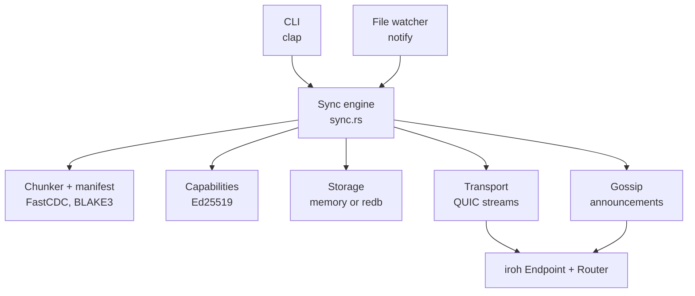
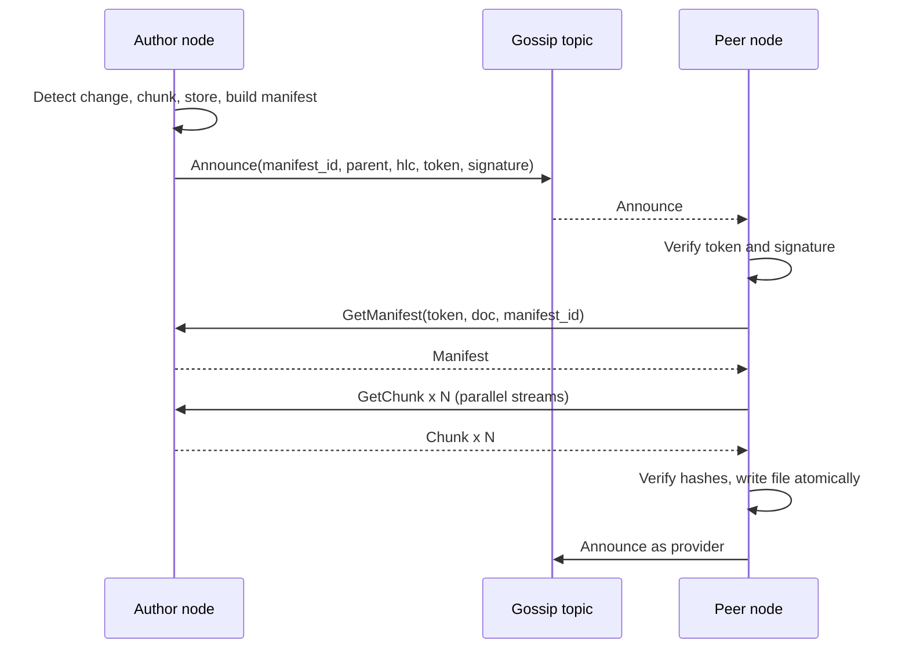

# p2p-sync-poc: Specification

2026-09-20

## 1. Overview

`p2p-sync-poc` is a Rust proof of concept that syncs a directory between peers with no central server. It combines content-defined chunking, capability-based access control and QUIC transport.

### Goals

- **Deduplicated transfer:** only chunks the receiver lacks cross the wire.
- **Zero-trust authorization:** every read and write is backed by a signed, scoped, expiring token bound to one peer.
- **Multi-source fetch:** missing chunks are pulled in parallel from every peer that holds them.
- **End-to-end verification:** every byte is checked against its BLAKE3 hash before it is stored.
- **Hermetic tests:** the full suite runs on loopback with no relay or internet.

### Non-goals (PoC)

- Deletions and tombstones; renames are seen as delete plus create.
- Automatic merging of concurrent edits. Conflicts are detected and settled by rule (section 8), and the loser republishes.
- Chunk garbage collection.
- Delegation chains and revocation lists; one owner key signs all tokens.
- Encryption at rest and files larger than 256 MiB (files are chunked in memory).

### Success criteria

1. Three nodes: A adds a 10 MiB file; B and C receive byte-identical copies via gossip announcement and QUIC fetch.
2. Changing one byte mid-file makes peers fetch at most 3 chunks plus the new manifest.
3. Forged, expired, wrong-audience, wrong-document and read-only-for-write tokens are all rejected, and no chunk bytes are served.
4. Two peers that edit the same file from the same version while disconnected converge, once reconnected, on the version with the smaller (`hlc`, `author`). The other version is kept locally under `.p2p-sync/rejected/` and never announced, and its author's next save builds on the winner.
5. All four quality gates in section 11 pass at every commit.

### Glossary

| Term | Meaning |
| --- | --- |
| Document | A synced directory tree, identified by a 32-byte `DocID` |
| Owner key | The Ed25519 key that is the sole trusted token issuer for a document |
| `NodeId` | A peer's Ed25519 public key, proven by the QUIC handshake. iroh 1.x calls it `EndpointId` |
| Capability token | Signed grant of read or write on one document to one peer for a time window |
| Chunk | A FastCDC slice of a file (8 / 16 / 32 KiB min / avg / max), addressed by its BLAKE3 hash |
| Manifest | Ordered chunk list for one file version, addressed by its `ManifestId` |
| Topic | The gossip channel for one document, derived from `DocID` and a secret salt |
| Invite | The bundle a new peer needs to join: `DocID`, owner public key, salt, token and bootstrap `NodeId`s |

## 2. Threat model and security requirements

Authorization holds only if a token is checked against a trusted issuer, bound to the peer presenting it, and scoped to the data requested. The first draft checked only that a token was signed by the key inside it, which any attacker can satisfy.

### Assumptions

- Peers are authenticated by iroh: the QUIC/TLS handshake proves the remote `NodeId` (an Ed25519 public key).
- The document owner's private key stays offline or on the owner's device.
- Gossip topics, relays and the network path are untrusted. Any topic member can read and forge topic traffic.

### Adversaries

| Adversary | Capability | Must not be able to |
| --- | --- | --- |
| Stranger | Reaches a peer's endpoint | Read any chunk or manifest |
| Token forger | Signs tokens with own key | Get any token accepted |
| Token thief | Copies a valid token off the wire or gossip | Use it from a different `NodeId` |
| Curious member | Holds a read token for document A | Read chunks of document B |
| Read-only member | Holds `can_read` only | Have an announcement accepted |
| Resource abuser | Sends oversized or malformed frames | Exhaust memory, CPU or connections |

### Requirements

| ID | Requirement |
| --- | --- |
| SEC-1 | A token is valid only if `issuer` equals the owner public key the node has configured for that `DocID`. |
| SEC-2 | A token carries an `audience` `NodeId`. The server rejects it unless `audience` equals the authenticated remote `NodeId` of the connection. |
| SEC-3 | A token names one `DocID`. Every request is checked against it, and a chunk is served only if some manifest of that document references it. |
| SEC-4 | Tokens have `not_before` and `expires_at`; verification allows 60 s of clock skew. |
| SEC-5 | Signatures are checked with `verify_strict` over a domain-separated payload (`"p2p-sync-poc/cap/v1"` prefix). |
| SEC-6 | Gossip announcements are signed by the author's `NodeId` key and carry the author's write token. A receiver accepts one only if the token is valid, has `can_write`, and names the author as audience. |
| SEC-7 | Every length prefix is capped before allocation (see the limits table in section 6). Deserialization uses size-limited bincode options. |
| SEC-8 | Every received chunk is hashed and compared with the requested hash before storage. Every received manifest is re-hashed and compared with the announced `ManifestId`. |
| SEC-9 | `file_name` in a manifest is a relative path of normal components only. It never contains `..`, a root, a drive prefix or NUL, and never resolves outside the document directory. |
| SEC-10 | Errors returned to peers are coarse codes. Details go to local logs only. |

### Accepted residual risks

- A token holder can share the data they read. Capabilities control who fetches, not what recipients do next.
- The topic salt is a shared secret. Anyone who has it can join the gossip channel and see announcement metadata, though not file bytes.
- No revocation before `expires_at`. Use short lifetimes; a revocation list is future work.

## 3. Architecture

A sync engine coordinates five components: chunker, capabilities, storage, transport and gossip. The file watcher and CLI drive it from above, and one iroh endpoint carries all network traffic from below.



The engine never talks to the network directly. Transport serves and fetches chunks and manifests. Gossip only announces that a new manifest exists.

### Update flow



Peers that finish a sync announce themselves as providers, so later joiners fetch from several sources.

### Design decisions

- **One endpoint, one router.** Gossip and the sync protocol use different ALPNs on the same iroh endpoint, dispatched by iroh's `Router`. The first draft registered only the sync ALPN, so gossip could not have accepted connections.
- **Stateless request auth.** Every request stream carries its own token (about 180 bytes). Streams on a QUIC connection can arrive in any order, so no per-connection session state is needed.
- **Pull, not push.** Announcements carry identifiers, never file bytes. Receivers decide what to fetch.
- **Manifests are fetchable.** The first draft announced a root hash but had no way to obtain the chunk list behind it. The protocol now has an explicit `GetManifest`.
- **Tokens scope a document, not a manifest.** A manifest hash changes on every edit, so a token tied to it would expire on the next save.

## 4. Technology stack

The stack is Rust 2021 on tokio, with iroh 1.2 for QUIC and gossip. The versions below are the current stable releases as of 2026-09-21; the first draft's 2024-era pins (iroh 0.28, redb 2, notify 6, bincode 1.3, rand 0.8, ed25519-dalek 2, fastcdc 3) were replaced before stage 5 (see `NOTES.md`). Third-party calls must still be checked against the pinned versions before use.

| Concern | Crate | Version | Notes |
| --- | --- | --- | --- |
| Async runtime | `tokio` | 1.47+, `full` | |
| Transport, NAT traversal | `iroh` | 1.2 | `Endpoint`, `protocol::Router`, relays and address lookup. iroh 1.x calls a peer's public key `EndpointId` and its address `EndpointAddr`; this spec says `NodeId` for the concept |
| Signaling | `iroh-gossip` | 0.101 | Must depend on the same `iroh` 1.x |
| Chunking | `fastcdc` | 5.0 | Use `fastcdc::v2020::FastCDC`; sizes are `usize` |
| Hashing | `blake3` | 1.8 | Chunk hashes, manifest IDs, topic IDs |
| Signatures | `ed25519-dalek` | 3.0 | Features `serde` and `rand_core`; `rand_core` 0.10 |
| Randomness | `rand` | 0.10 | `rand::rng()` is the CSPRNG; `OsRng` no longer exists |
| Serialization | `serde`, `bincode` | 1.0, 2.0 (`serde` feature) | Always through the size-limited helpers in `protocol.rs`. bincode 3.0.0 on crates.io is an empty placeholder |
| Storage | `redb` | 4.3 | Disk backend; in-memory backend needs no crate |
| Locking | `parking_lot` | 0.12 | No lock poisoning |
| File events | `notify` | 8.2 | |
| CLI | `clap` | 4.5, `derive` | |
| Errors | `thiserror`, `anyhow` | 2.0, 1.0 | `thiserror` in library modules, `anyhow` in `main.rs` |
| Logging | `tracing`, `tracing-subscriber` | 0.1, 0.3 | Feature `env-filter` |
| Streams | `futures-lite` | 2 | For consuming gossip events |
| Dev | `tempfile`, `proptest` | 3.20, 1.7 | |

The minimum supported Rust version is set by iroh, not by this project: iroh 1.2 declares `rust-version = "1.91"`, and `Cargo.toml` copies it.

### Cargo.toml

```toml
[package]
name = "p2p-sync-poc"
version = "0.1.0"
edition = "2021"
rust-version = "1.91"

[dependencies]
tokio = { version = "1.47", features = ["full"] }
iroh = "1.2"
iroh-gossip = "0.101"
fastcdc = "5.0"
blake3 = "1.8"
ed25519-dalek = { version = "3.0", features = ["serde", "rand_core"] }
rand = "0.10"
serde = { version = "1.0", features = ["derive"] }
bincode = { version = "2.0", features = ["serde"] }
redb = "4.3"
parking_lot = "0.12"
notify = "8.2"
clap = { version = "4.5", features = ["derive"] }
anyhow = "1.0"
thiserror = "2.0"
tracing = "0.1"
tracing-subscriber = { version = "0.3", features = ["env-filter"] }
futures-lite = "2"
hex = "0.4"

[dev-dependencies]
tempfile = "3.20"
proptest = "1.7"

[lints.rust]
unsafe_code = "forbid"

[lints.clippy]
unwrap_used = "deny"
```

Add a `clippy.toml` containing `allow-unwrap-in-tests = true`. The crate is both a library (`src/lib.rs`) and a binary (`src/main.rs`) so that files under `tests/` can import it. Commit `Cargo.lock`.

### iroh calls to verify before use

The snippets in this spec show intent. Confirm each of these against docs.rs for the exact pinned versions, and adapt the code rather than the versions if they differ. Findings for iroh 1.2 and iroh-gossip 0.101 are recorded here.

1. `SecretKey::generate()` takes no RNG. `Endpoint::builder(preset)` needs a preset: `presets::N0` for production (relays plus pkarr address lookup), `presets::Minimal` plus `relay_mode(RelayMode::Disabled)` for tests. Loopback binding is `clear_ip_transports().bind_addr((Ipv4Addr::LOCALHOST, 0))`.
2. Accept path: `iroh::protocol::{Router, ProtocolHandler}`. The handler trait is `async fn accept(&self, conn: Connection) -> Result<(), AcceptError>`, so the handler keeps its state behind an `Arc` to spawn per-stream tasks. `RouterBuilder::spawn()` is synchronous.
3. The authenticated remote identity is `Connection::remote_id() -> EndpointId`, infallible. SEC-2 depends on it.
4. `SendStream` and `RecvStream` (from iroh's `noq` QUIC fork) implement tokio `AsyncRead` and `AsyncWrite`, so the frame helpers use `read_exact` and `write_all` from tokio.
5. `iroh_gossip::net::Gossip::builder().spawn(endpoint)`, registered on the router under `iroh_gossip::ALPN`. `subscribe(topic, bootstrap)` returns at once; `subscribe_and_join` waits for a neighbor. Events are `Received`, `NeighborUp`, `NeighborDown` and `Lagged` (there is no `Joined`). The default maximum message size is 4 KiB.
6. Transport limits go through `iroh::endpoint::QuicTransportConfig`: `max_concurrent_bidi_streams(VarInt)` and `max_idle_timeout(Option<IdleTimeout>)`, passed to `Builder::transport_config`.
7. Dialing by ID needs an address lookup. Tests and invites use `iroh::address_lookup::memory::MemoryLookup`, registered with `Builder::address_lookup`, and add `EndpointAddr`s to it.

## 5. Data model

Three structures carry the system: chunks addressed by content hash, manifests addressed by a hash of their chunk list, and capability tokens scoped to a document. All hashes are 32-byte BLAKE3 digests, aliased as `Hash`.

### Chunking

| Parameter | Value |
| --- | --- |
| Algorithm | `fastcdc::v2020::FastCDC` |
| Minimum / average / maximum chunk | 8,192 / 16,384 / 32,768 bytes |
| Chunk ID | `blake3::hash(chunk_bytes)` |
| Maximum file size | 256 MiB (whole file held in memory) |
| Empty file | Zero chunks, `total_size` 0 |

### Manifest

A manifest lists the chunks of one file version in order. Its ID is derived, never sent on the wire as a trusted value: receivers always recompute it.

```rust
pub type Hash = [u8; 32];

#[derive(Serialize, Deserialize, Clone, Debug, PartialEq, Eq)]
pub struct ChunkRef {
    pub hash: Hash,
    pub length: u32, // 1..=32768; offsets are the running sum of lengths
}

#[derive(Serialize, Deserialize, Clone, Debug, PartialEq, Eq)]
pub struct FileManifest {
    pub file_name: String, // relative path, '/' separators
    pub total_size: u64,
    pub chunks: Vec<ChunkRef>,
}
```

The manifest ID is a BLAKE3 hash in key-derivation mode, so it can never collide with a chunk hash:

1. Start `blake3::Hasher::new_derive_key("p2p-sync-poc manifest v1")`.
2. Feed `file_name` length as `u64` little-endian, then the name bytes.
3. Feed `total_size` and the chunk count, each as `u64` little-endian.
4. For each chunk feed its `hash`, then its `length` as `u32` little-endian.

This is a depth-1 Merkle tree: chunk hashes are the leaves and the manifest ID is the root. A deeper tree, or BLAKE3's native tree with verified streaming, is future work.

`FileManifest::validate` must reject a manifest unless all of these hold:

- `total_size` is at most 256 MiB and equals the sum of chunk lengths.
- Every chunk length is between 1 and 32,768, and the chunk count is at most 32,768.
- `file_name` is non-empty, at most 1,024 bytes, and contains no NUL, backslash, empty component, `.` or `..`, and does not start with `/` or contain a drive prefix (SEC-9).

### Capability token

```rust
#[derive(Serialize, Deserialize, Clone, Debug, PartialEq, Eq)]
pub struct CapabilityClaims {
    pub doc_id: Hash,
    pub audience: [u8; 32], // NodeId of the only peer allowed to present it
    pub can_read: bool,
    pub can_write: bool,
    pub not_before: u64,    // unix seconds
    pub expires_at: u64,    // unix seconds
}

#[derive(Serialize, Deserialize, Clone, Debug, PartialEq, Eq)]
pub struct CapabilityToken {
    pub claims: CapabilityClaims,
    pub issuer: [u8; 32],
    pub signature: ed25519_dalek::Signature, // `serde` feature
}
```

The signed payload has a fixed layout, so signer and verifier cannot disagree on encoding:

`b"p2p-sync-poc/cap/v1"` ‖ `doc_id` ‖ `audience` ‖ flags byte (bit 0 read, bit 1 write) ‖ `not_before` LE ‖ `expires_at` LE ‖ `issuer`

Verification is two steps, and both are mandatory:

```rust
impl CapabilityToken {
    /// SEC-1, SEC-4, SEC-5: issuer is the trusted owner key, signature is
    /// valid (verify_strict), and now is within [not_before - skew, expires_at + skew].
    pub fn verify(&self, trusted_issuer: &[u8; 32], now: u64) -> Result<&CapabilityClaims, AuthError>;

    /// SEC-2, SEC-3: doc matches, audience equals the authenticated peer,
    /// and the requested permission is granted.
    pub fn authorize(&self, doc_id: &Hash, peer: &[u8; 32], need: Permission) -> Result<(), AuthError>;
}
```

`AuthError` variants: `UntrustedIssuer`, `InvalidPublicKey`, `InvalidSignature`, `NotYetValid`, `Expired { expires_at, now }`, `WrongDocument`, `WrongAudience`, `InsufficientPermission`. `can_write` does not imply `can_read`; each is checked separately.

### Topic ID

The topic is a keyed BLAKE3 hash, so the salt acts as the key and the inputs cannot be confused by concatenation:

`topic_id = blake3::Hasher::new_keyed(salt).update(b"p2p-sync-poc/topic/v1").update(doc_id).finalize()`

The salt is exactly 32 random bytes, generated at document creation and distributed only in invites. `DocID` is 32 random bytes generated by `init`.

### Versions and hybrid logical clock

Every file has a chain of versions. A version is a signed `NewVersion` message (section 7) that names the version it was built on, its parent. The chain, not a timestamp, is what makes an update consistent.

```rust
pub type VersionId = [u8; 32];

#[derive(Serialize, Deserialize, Clone, Copy, Debug, PartialEq, Eq, PartialOrd, Ord)]
pub struct Hlc {
    pub wall_ms: u64,  // field order matters: derived Ord compares wall_ms first
    pub counter: u32,
}
```

`VersionId` is a BLAKE3 derive-key hash (context `"p2p-sync-poc version v1"`) over `doc_id`, `manifest_id`, the parent (a presence byte, then the 32 bytes if present), `hlc` and `author`. A manifest ID is not enough to identify a version, because reverting a file to old content produces an old manifest ID again.

The clock lives in `clock.rs` and is persisted in storage so a restart never moves it backwards:

- **Local event or send:** `wall = max(physical_now, last.wall)`. If `wall` equals `last.wall`, `counter = last.counter + 1`, otherwise `counter = 0`.
- **Observing a remote value:** reject it if `remote.wall_ms` is more than 5 minutes ahead of `physical_now`. Otherwise set `wall` to the maximum of `physical_now`, `last.wall` and `remote.wall_ms`. The counter is the largest counter among the inputs that share that `wall`, plus 1, or 0 if only `physical_now` supplied it.
- **Ordering:** `Hlc` values compare by (`wall_ms`, `counter`). Two versions are ordered by (`hlc`, `author`), and the smaller one is the earlier commit.

A node observes the `hlc` of every version it accepts, and before publishing it observes its parent's `hlc`. So a child always has a larger `hlc` than its parent, and the clock respects causality even when physical clocks disagree.

## 6. Wire protocol

Each request is one bidirectional QUIC stream: the client sends one length-prefixed request, the server answers with one length-prefixed response and finishes the stream. Many streams share one connection.

### Connection and framing

- **ALPN:** `b"p2p-sync-poc/sync/v1"`. The draft's `systemy-rozproszone/sync/v1` was a course leftover.
- **Frame:** 4-byte big-endian length, then a bincode payload. The length is checked against the limit for that direction before any buffer is allocated.
- **Encoding:** all frames go through `protocol::encode` and `protocol::decode`, which share one `bincode::DefaultOptions` value with a size limit and `reject_trailing_bytes`. Plain `bincode::serialize` uses different options and must not be mixed in.
- **Identity:** the server reads the peer's authenticated `NodeId` once per connection and uses it for every stream on that connection.

### Messages

```rust
pub enum Request {
    GetManifest { token: CapabilityToken, doc_id: Hash, manifest_id: Hash },
    GetChunk    { token: CapabilityToken, doc_id: Hash, hash: Hash },
    GetHeads    { token: CapabilityToken, doc_id: Hash },
    GetVersion  { token: CapabilityToken, doc_id: Hash, version_id: VersionId },
}

pub enum Response {
    Manifest(FileManifest),
    Chunk(Vec<u8>),
    Heads(Vec<SyncMessage>), // latest signed NewVersion per file, at most 1,024
    Version(SyncMessage),    // one stored signed NewVersion, by id
    Error(ErrorCode),
}

pub enum ErrorCode { Unauthorized, Forbidden, NotFound, BadRequest, Busy, Internal }
```

### Server behavior per stream

1. Read the frame length. If it exceeds the request limit, reset the stream without a response.
2. Read and decode the request within the frame timeout.
3. `token.verify(owner_key_for(doc_id), now)`. Failure gives `Unauthorized`; an unknown `doc_id` also gives `Unauthorized`.
4. `token.authorize(doc_id, peer, Permission::Read)`. Failure gives `Forbidden`.
5. `GetChunk`: serve only if `store.doc_has_chunk(doc_id, hash)`; otherwise `NotFound`. `GetManifest`: serve only if the manifest belongs to `doc_id`; otherwise `NotFound`. `GetHeads`: return the stored signed `NewVersion` messages for `doc_id`. `GetVersion`: return the stored signed `NewVersion` with that `VersionId`, including versions that were later rejected.
6. Write the response frame and call `finish()` on the send stream.

The connection stays open and the server keeps accepting streams until the client closes it. The draft returned right after one response, which drops the connection while data may still be in flight.

### Error mapping

| Condition | Code |
| --- | --- |
| Bad signature, untrusted issuer, expired, not yet valid, unknown document | `Unauthorized` |
| Wrong document, wrong audience, missing read permission | `Forbidden` |
| Chunk or manifest not held for this document | `NotFound` |
| Decode failure, trailing bytes, invalid hash length | `BadRequest` |
| Connection or stream capacity exceeded | `Busy` |
| Storage or internal failure | `Internal` |

The server logs the detailed `AuthError` locally and sends only the code (SEC-10).

### Limits

| Limit | Value |
| --- | --- |
| Request frame | 1 KiB |
| Response frame | 2 MiB (largest manifest is about 1.2 MiB; a full heads list about 0.4 MiB) |
| Chunk payload | 32 KiB |
| Frame read timeout | 10 s |
| Whole request timeout | 30 s |
| Concurrent streams per connection (server) | 64 |
| Connections in total / per peer | 256 / 4 |
| Connection idle timeout | 30 s |

These are constants in `protocol.rs`. Apply the stream and idle limits through the endpoint's transport configuration, and confirm the exact API for the pinned iroh version.

## 7. Gossip signaling

Gossip announces that a new manifest exists or that a peer can serve one; it never carries file data. Every announcement is signed by its sender and carries the sender's token, so any receiver can validate it without trusting the peers that relayed it.

### Topic

Each document has one gossip topic derived as in section 5. Peers join with the bootstrap `NodeId`s from their invite. Because the topic ID depends on a secret salt, only invited peers can find the topic.

### Messages

```rust
pub enum SyncMessage {
    /// A signed version of a file, built on `parent`.
    NewVersion {
        doc_id: Hash,
        manifest_id: Hash,
        parent: Option<VersionId>, // None only when the file is created
        hlc: Hlc,
        author: [u8; 32],      // NodeId of the signer
        token: CapabilityToken, // needs can_write, audience == author
        signature: Signature,
    },
    /// The sender holds this manifest and all its chunks, and can serve them.
    Have {
        doc_id: Hash,
        manifest_id: Hash,
        provider: [u8; 32],    // NodeId of the signer
        token: CapabilityToken, // needs can_read, audience == provider
        signature: Signature,
    },
}
```

The signature is made with the sender's endpoint secret key over `b"p2p-sync-poc/msg/v1"` ‖ a variant tag byte ‖ every field except `token` and `signature`, in the order listed. It is checked with the sender's `NodeId`. Because the token is bound to that same `NodeId`, copying an announcement from the wire gives an attacker nothing they can reuse.

The draft's `HaveChunksAnnounce` carried an unbounded list of chunk hashes. It is dropped. Providers are found through `Have` messages at manifest granularity.

### Receiver validation

Run these checks in order and drop the message on the first failure, logging at `debug` level:

1. The frame is at most 1 KiB and decodes with the size-limited helper.
2. `doc_id` equals the document this topic belongs to.
3. `token.verify` against the document's owner key, then `token.authorize` for `Write` (`NewVersion`) or `Read` (`Have`), with the token's audience equal to the signer's `NodeId`.
4. The signature verifies under the signer's `NodeId`.
5. For `NewVersion`, the clock accepts `hlc` (no more than 5 minutes ahead of local physical time). Parent and ordering checks are not made here: they need the local version chain and belong to the apply rules in section 8.
6. The message has not been handled already: a `NewVersion` by its `VersionId`, a `Have` by (`manifest_id`, signer). Keep the last 4,096 keys in an LRU set.

Gossip forwards messages before this code sees them, so every node must validate independently and must not assume that a message it received was checked upstream.

### Catching up

Gossip does not replay history, so a peer that joins late or was offline would never learn about existing files. Two mechanisms cover this:

- On startup, and every 5 minutes after, a peer calls `GetHeads` (section 6) on one random known provider. It returns the latest signed `NewVersion` for each file, and each entry is validated exactly like a live announcement. When an entry's parent is unknown locally, the peer walks back through ancestors with `GetVersion` (section 8).
- A peer that finishes a sync broadcasts `Have`, so joiners see more than the original author as a source.

### Peer discovery

Production uses iroh's default relay and discovery. Tests disable the relay and exchange `NodeAddr`s directly so that they run on loopback.

## 8. Sync algorithm and conflict rules

Divergence is a normal state here, so conflicts are settled by rule, not by a coordinator. An update must be built on the current head of its file, and among updates built on the same parent the earliest commit wins. The loser is rejected and must publish a new update on top of the winner.

### Conflict rules

| ID | Rule |
| --- | --- |
| CON-1 | Every version names its parent (`None` only when the file is created). A node may publish only when that parent equals its own head for the file at commit time. |
| CON-2 | The check is a local compare-and-set made before the version is signed, before its chunks become servable and before anything is broadcast. If it fails, nothing leaves the node. |
| CON-3 | Among versions with the same parent, the smallest (`hlc`, `author`) wins on every node, whatever order the versions arrive in. |
| CON-4 | A version becomes head only by extending the head or by winning a fork. The losing branch is rejected, and so is any version built on a rejected version. |
| CON-5 | A version's `hlc` must be greater than its parent's `hlc`, and no more than 5 minutes ahead of the receiver's physical clock. |
| CON-6 | A rejected version is never silently discarded. Its bytes are kept under `.p2p-sync/rejected/`, the file on disk becomes the winner's content, and the author must publish a new version on top of the winner. |

### Publishing a local change

Steps 2 to 6 run under a per-file async lock, shared with the apply pipeline below.

1. The watcher reports a path. Wait until no event has arrived for it for 500 ms, then read it. Skip anything under `.p2p-sync/`.
2. Read the current head `H` for the file (`None` for a new file). Chunk the bytes, store the chunks, and build and validate the manifest. The chunks are not yet servable to anyone.
3. If the manifest ID equals `H`'s, stop. This covers no-op saves and the echo of a write the engine made itself.
4. Observe `H.hlc`, take `hlc = clock.now()`, and build a `NewVersion` with `parent = H.version_id`. Sign it with the endpoint key and this peer's write token.
5. Call `store.commit_version(..., expected_head = H.version_id)`. This is an atomic compare-and-set that also registers the chunks for the document. If it returns `HeadMoved`, a remote version was applied since step 2. Abort: nothing was broadcast (CON-2). Keep the bytes read in step 2 under `.p2p-sync/rejected/`, and report the rejection as in "When your version is rejected".
6. Only after the commit succeeds, broadcast the signed message.

### Applying a remote version

For every validated `NewVersion` `V` for file `f`, under the per-file lock, let `H` be the local head. Take the first row that matches.

| Case | Action |
| --- | --- |
| `V` is already known, accepted or rejected | Ignore |
| `V.parent` is a rejected version | Record `V` as rejected |
| `H` is `None` | Bootstrap: apply `V` as the first known head. If `V.parent` is unknown, first fetch its ancestors with `GetVersion` (at most 64 steps), validate each and store them with `record_version` so later forks can be resolved; if they cannot be fetched, apply `V` anyway without verifying its ancestry |
| `V.parent == H.version_id` | Fast-forward: require `V.hlc > H.hlc`, then apply `V` |
| `V.parent` equals the parent of some version `R` on the local chain from `H` backwards (`R` may be `H`) | Fork at that parent. Compare (`V.hlc`, `V.author`) with (`R.hlc`, `R.author`). If `R` is smaller, record `V` as rejected. If `V` is smaller, apply `V` and reject `R` and every version after it up to `H` |
| `V.parent` is unknown and matches nothing above | Gap: fetch ancestors with `GetVersion`, at most 64 steps back, validate each, then process them oldest first by these rows. If they never connect, drop `V` and log |

The final head depends only on the set of versions a node has seen, not on their arrival order, once gaps are filled. Stage 7 tests this with random delivery orders.

To apply a winning version:

1. Fetch the manifest from a provider (the author, plus peers that sent `Have`). Recompute its ID, require it to equal `V.manifest_id`, and run `validate` (section 5).
2. Fetch the missing chunks with `ParallelFetcher` (below).
3. Preserve anything about to be lost (CON-6). For each version this node authored that is being rejected, reassemble its file from the store into `.p2p-sync/rejected/<file_name>.<8 hex of VersionId>`. If the file on disk differs from the current head, keep that unpublished edit there too.
4. Commit in one storage transaction: set the head to `V`, register `V`'s chunks, record the rejected versions, and mark the head as not yet written to disk.
5. Write the file: assemble into a temporary file under `.p2p-sync/tmp/`, `fsync`, then rename over the target. Create parent directories first, and confirm the resolved path is inside the document directory (SEC-9). Then mark the head as written.
6. Observe `V.hlc` on the clock, record the write for echo suppression, and broadcast `Have`.

Commit happens before the write so that a crash between them cannot leave a winner's content on disk under an old head, which the watcher would publish as a new edit. At startup, any head not marked as written is written again before the watcher starts.

Applying the same version twice is a no-op. Chunks fetched before a failure stay in the store, so a retry resumes where it stopped. They become servable to others only at step 4.

### When your version is rejected

The node emits a `VersionRejected` event with the file, the version, where the bytes were kept, and the winning version. `status` lists these until the user clears them. The file on disk already holds the winner's content.

To continue, the author edits the winner's file, or merges from the kept copy, and saves. That save is a new version whose parent is the winner, so it is consistent by construction. The node never re-announces a rejected version and never publishes with a parent other than its current head. `.p2p-sync/rejected/` is not watched.

### Parallel fetcher

```rust
pub struct ParallelFetcher { /* endpoint, store, connection pool, limits */ }

impl ParallelFetcher {
    pub async fn fetch_missing(
        &self,
        ctx: &DocContext,          // doc_id and the local read token
        manifest: &FileManifest,
        providers: &[NodeId],
    ) -> Result<FetchReport, SyncError>;
}
```

| Rule | Value |
| --- | --- |
| Connections | One per provider, kept in a pool; one stream per chunk request |
| Concurrency | 16 streams per provider, 32 overall, enforced with an owned semaphore permit |
| Provider choice | Round-robin over providers, skipping any that failed 3 requests in a row for 60 s |
| Retries | Up to 3 attempts per chunk, on a different provider when possible; 100, 200, 400 ms backoff plus jitter |
| Per-chunk check | Response length equals the manifest's `length` and `blake3(bytes)` equals the requested hash, before `put_chunk` |
| Failure | On a fatal error abort all outstanding tasks (use `JoinSet`) and return the error |
| Limit per document | At most 4 manifests in flight |

The draft opened a new QUIC connection for every chunk and awaited tasks in order with `??`, which leaves the rest running after the first failure. Both are replaced by the pool and `JoinSet` above.

### What "earliest" means

The hybrid logical clock keeps versions ordered consistently with causality even when physical clocks disagree. For concurrent branches, "earliest" means the smallest `hlc`, which tracks physical time to within clock skew. A peer whose clock runs slow wins more forks. A writer can backdate a version, but only to just above its parent's `hlc` (CON-5), and writers already hold write permission. Section 14 lists this as a risk.

## 9. Storage engine

Storage is a small trait with two backends: an in-memory one for tests and a `redb` one for real use. Chunks are global and content-addressed, while manifests, chunk membership and heads are scoped per document.

### Trait

```rust
pub trait Store: Send + Sync + 'static {
    fn has_chunk(&self, hash: &Hash) -> Result<bool, StoreError>;
    /// Rejects data whose BLAKE3 hash is not `hash` (defense in depth for SEC-8).
    fn put_chunk(&self, hash: Hash, data: Vec<u8>) -> Result<(), StoreError>;
    fn get_chunk(&self, hash: &Hash) -> Result<Option<Vec<u8>>, StoreError>;

    /// True if some committed manifest of `doc` references this chunk (SEC-3).
    fn doc_has_chunk(&self, doc: &Hash, hash: &Hash) -> Result<bool, StoreError>;
    fn get_manifest(&self, doc: &Hash, id: &Hash) -> Result<Option<FileManifest>, StoreError>;

    /// A stored signed NewVersion, whether accepted or rejected.
    fn version(&self, doc: &Hash, id: &VersionId) -> Result<Option<SyncMessage>, StoreError>;
    fn is_rejected(&self, doc: &Hash, id: &VersionId) -> Result<bool, StoreError>;
    /// Stores the version (if new) and marks it rejected. No chunks are registered.
    fn record_rejected(&self, doc: &Hash, version: &SyncMessage) -> Result<(), StoreError>;
    /// Stores a signed NewVersion learned through GetVersion (if new) without
    /// touching any head, chunk registration or rejection mark.
    fn record_version(&self, doc: &Hash, version: &SyncMessage) -> Result<(), StoreError>;

    fn head(&self, doc: &Hash, file_name: &str) -> Result<Option<HeadInfo>, StoreError>;
    fn heads(&self, doc: &Hash) -> Result<Vec<SyncMessage>, StoreError>;

    /// Compare-and-set (CON-1, CON-2). In one transaction: fails with
    /// `StoreError::HeadMoved` unless the file's head equals `expected_head`;
    /// otherwise stores the manifest and version, registers the manifest's
    /// chunks for `doc`, and moves the head. `written` says whether the file
    /// on disk already matches (true for local publishes, false for remote applies).
    fn commit_version(
        &self, doc: &Hash, manifest: &FileManifest, version: &SyncMessage,
        expected_head: Option<VersionId>, written: bool,
    ) -> Result<(), StoreError>;

    /// Like `commit_version` for a fork winner, and in the same transaction
    /// marks every id in `rejected` as rejected. The head is left unwritten.
    fn switch_branch(
        &self, doc: &Hash, manifest: &FileManifest, version: &SyncMessage,
        expected_head: VersionId, rejected: &[VersionId],
    ) -> Result<(), StoreError>;

    fn mark_written(&self, doc: &Hash, file_name: &str, id: &VersionId) -> Result<(), StoreError>;
    fn unwritten_heads(&self, doc: &Hash) -> Result<Vec<HeadInfo>, StoreError>;

    fn load_clock(&self) -> Result<Hlc, StoreError>;
    fn save_clock(&self, hlc: Hlc) -> Result<(), StoreError>;
}

pub struct HeadInfo {
    pub version_id: VersionId,
    pub manifest_id: Hash,
    pub hlc: Hlc,
    pub author: [u8; 32],
    pub written: bool,
}
```

The draft's `StorageEngine` had no notion of a document, so it could not answer whether a chunk belongs to a document. It also stored manifests keyed by a root hash the manifest itself supplied. Both are fixed here.

### redb tables

| Table | Key | Value |
| --- | --- | --- |
| `chunks` | chunk hash | chunk bytes |
| `manifests` | (`doc_id`, `manifest_id`) | bincode `FileManifest` |
| `doc_chunks` | (`doc_id`, chunk hash) | unit |
| `versions` | (`doc_id`, `version_id`) | bincode signed `NewVersion`: accepted, rejected, or a recorded ancestor |
| `rejected` | (`doc_id`, `version_id`) | unit |
| `heads` | (`doc_id`, `file_name`) | bincode `HeadInfo` |
| `meta` | name | bincode `Hlc` (the persisted clock) |

If tuple or array keys are awkward in the pinned `redb` version, use a single 64-byte concatenated key for the tables keyed by two hashes.

### Rules

- `commit_version` and `switch_branch` are each one write transaction. Either the manifest, version, chunk registrations, head and rejections are all visible, or none are.
- The `expected_head` comparison happens inside that transaction. A race between a local publish and a remote apply therefore ends in `HeadMoved` for one of them, never in a lost update.
- Chunk writes are idempotent and independent of commits. A fetched chunk can sit in `chunks` unregistered; it becomes servable to a document only after a commit registers it (section 8).
- A rejected version's chunks stay registered if they were registered before the rejection, so peers still fetching them can finish.
- The trait is synchronous. Async callers wrap `redb` calls in `spawn_blocking`. The in-memory backend uses `parking_lot::RwLock`, and no lock is ever held across an `.await`.
- The `redb` file lives at `<doc_dir>/.p2p-sync/store.redb`. Temporary files in `.p2p-sync/tmp/` are deleted at startup, and heads reported by `unwritten_heads` are written to disk before the watcher starts.
- There is no deletion or garbage collection. Old chunks stay until the store is discarded.

## 10. Module layout and conventions

The crate is a library plus a thin binary, with one module per concern and no module reaching around another. The library target is required so that integration tests under `tests/` can import the crate.

### Modules

| File | Responsibility |
| --- | --- |
| `src/main.rs` | CLI entry point only: parse arguments, set up logging, call into the library |
| `src/lib.rs` | Module declarations, `#![forbid(unsafe_code)]`, shared `Hash` alias |
| `src/crypto.rs` | Domain-separated hashing: chunk hash, manifest ID, version ID, topic ID; key generation |
| `src/capabilities.rs` | `CapabilityClaims`, `CapabilityToken`, `AuthError`, `Permission` |
| `src/clock.rs` | Hybrid logical clock: `Hlc` and `HlcClock`, persisted through storage |
| `src/chunker.rs` | FastCDC chunking; returns a manifest plus chunk bytes |
| `src/manifest.rs` | `ChunkRef`, `FileManifest`, ID computation, `validate`, path checks |
| `src/protocol.rs` | Wire types, limits, `encode` and `decode`, frame helpers |
| `src/storage.rs` | `Store` trait with compare-and-set commits and rejection records, `MemStore`, `RedbStore` |
| `src/transport.rs` | Iroh endpoint and router, sync protocol handler, client connection pool |
| `src/gossip.rs` | `SyncMessage`, signing and verification, topic subscription |
| `src/sync.rs` | Publish and apply pipelines, `ParallelFetcher`, fork and rejection rules |
| `src/watcher.rs` | `notify` integration, debounce, echo suppression |
| `tests/` | Integration and adversarial tests using the public API |

The draft listed `crypto.rs` but gave it no content, and put `FileManifest` in `chunker.rs` beside an empty `manifest.rs`. The split above gives each file one job.

### Files on disk

Everything the tool owns lives under `<doc_dir>/.p2p-sync/`, which the watcher ignores.

| Path | Contents | Notes |
| --- | --- | --- |
| `node.key` | This peer's endpoint secret key | Mode 0600 |
| `owner.key` | Owner signing key | Present only on the owner's machine; mode 0600 |
| `config.toml` | `doc_id`, owner public key, topic salt, own token, bootstrap `NodeId`s | The salt and token are secrets; mode 0600 |
| `store.redb` | Chunks, manifests, versions, heads, clock | |
| `tmp/` | Files being assembled | Emptied at startup |
| `rejected/` | Copies of rejected versions and of unpublished edits displaced by a remote version | Never watched or announced |

### Conventions

- **Errors:** each module defines a `thiserror` enum; `sync.rs` aggregates them into `SyncError`. `anyhow` appears only in `main.rs`. No `unwrap` or `expect` outside tests; `clippy::unwrap_used` is denied.
- **Logging:** use `tracing`. Never log tokens, keys or the salt. Log hashes as the first 8 hex characters.
- **Time:** functions that depend on the clock take `now` as a parameter, so tests control it.
- **Async:** no blocking I/O inside async functions, and no lock guard held across an `.await`.
- **Determinism:** nothing that is signed or hashed depends on map iteration order or on default serde output. Encodings are fixed in sections 5 to 7.
- **Docs:** every public item has a doc comment that states its security or invariant obligations, if any.

## 11. Quality gates and agent rules

Every commit must pass four gates, run in this order on the committed tree, before the next stage starts.

| Gate | Command | Pass condition |
| --- | --- | --- |
| Format | `cargo fmt --check` | No diff |
| Build | `cargo check --all-targets` | 0 errors |
| Lint | `cargo clippy --all-targets -- -D warnings` | 0 warnings |
| Test | `cargo test` | 100% of unit, integration and doc tests pass |

Keep the sequence in `scripts/gate.sh` so a human and an agent run the same thing:

```sh
#!/usr/bin/env bash
set -euo pipefail
cargo fmt --check
cargo check --all-targets
cargo clippy --all-targets -- -D warnings
cargo test
```

### Rules for the implementing agent

1. Implement one stage per commit, in the order of section 12. Name each commit `stage N: <title>`.
2. Never make a gate pass by weakening it: no `#[ignore]` on tests, no blanket `#[allow]` on lints, no loosened limits. A narrow `#[allow]` needs a comment saying why.
3. Before using a third-party API, read its docs for the pinned version (see the checklist in section 4). If a snippet in this spec does not compile, change the code to fit the API and record the difference in `NOTES.md`.
4. Change a dependency version only if resolution fails, and record why in `NOTES.md`. Add no crate that section 4 does not list without recording it.
5. The public signatures in sections 5 to 9 are contracts. If one must change, update this spec in the same commit.
6. Every requirement `SEC-1` to `SEC-10` needs at least one test whose name or doc comment cites its ID.
7. If the same gate failure survives three consecutive fix attempts, stop and report the exact failing output instead of working around it.

## 12. Implementation plan

The work is ten stages, one commit each. Stages 1 to 4 have no networking, so their tests are fast and hermetic; stages 5 to 7 add the network one layer at a time; stages 8 to 10 close the loop with the watcher, CLI and end-to-end tests. Every stage ends with the four gates from section 11.

| Stage | Deliverable | Main modules |
| --- | --- | --- |
| 1 | Project skeleton and dependency graph | all (stubs) |
| 2 | Capability tokens and domain-separated hashing | `crypto`, `capabilities` |
| 3 | Chunker, manifest, path validation | `chunker`, `manifest` |
| 4 | Store trait with memory and redb backends | `storage` |
| 5 | Wire protocol and authorized chunk serving | `protocol`, `transport` |
| 6 | Signed gossip announcements and topic subscription | `gossip` |
| 7 | Sync engine, parallel fetcher, catch-up | `sync`, `transport` |
| 8 | File watcher | `watcher` |
| 9 | CLI: init, whoami, invite, join, run, status | `main` |
| 10 | Three-node end-to-end and adversarial tests | `tests/` |

### Stage 1: Project skeleton

**Tasks**

- Create the package with the `Cargo.toml` from section 4, `clippy.toml`, `scripts/gate.sh` and an empty `NOTES.md`.
- Add `src/lib.rs` and `src/main.rs`, plus one file per module in section 10, each holding only a module doc comment.

**Gate tests:** the four gates pass on the empty skeleton, and `cargo check` resolves every crate with no version conflict.

### Stage 2: Capabilities and hashing

**Tasks**

- Implement `crypto.rs` (`derive_topic_id`, `version_id`, key helpers) and `capabilities.rs` exactly as in section 5, including the fixed signing layout and `verify_strict`.
- Implement `clock.rs`: `Hlc` and `HlcClock` with the local-event and observe rules from section 5.

**Gate tests**

- A valid token verifies and authorizes for read and for write independently.
- Expired and not-yet-valid tokens fail, with the 60 s skew boundary tested on both sides.
- SEC-1: a token signed by any key other than the trusted issuer fails.
- SEC-2 and SEC-3: wrong audience and wrong document each fail in `authorize`.
- SEC-5: changing any claim byte after signing fails verification.
- Topic IDs are deterministic, and differ when either the salt or the document ID differs.
- `HlcClock::now` is strictly increasing across calls, including when the physical clock stalls or steps backwards.
- `observe` rejects a remote value more than 5 minutes ahead. After `observe(r)`, the next `now` is greater than `r`. Ordering compares `wall_ms` before `counter`.
- `version_id` is deterministic and changes with any input, including when the manifest ID repeats after a revert to old content.

### Stage 3: Chunker and manifest

**Tasks**

- `chunker.rs`: `chunk_bytes(file_name, data) -> ChunkedPayload` using `fastcdc::v2020::FastCDC` with 8,192 / 16,384 / 32,768.
- `manifest.rs`: `FileManifest::id` and `validate`, including the path rules.

**Gate tests**

- Concatenating the chunks reproduces the input; results are deterministic; an empty file gives zero chunks; a file under 8 KiB gives one.
- Boundary stability: generate 4 MiB from a seeded PRNG, change one byte near the 1 MiB mark, and assert that every chunk before the changed one is identical, and that the chunks after the point where boundaries resynchronize are identical too. Do not assert that no boundary moves.
- The manifest ID changes when the name, size, or any chunk changes.
- `validate` rejects each case in the section 5 list, and a table of bad paths: `..`, `/etc/x`, `a//b`, `a\b`, an embedded NUL, `C:x`, empty, over 1,024 bytes (SEC-9).
- A `proptest` property: for arbitrary data up to 1 MiB, chunks concatenate to the input and the manifest validates.

### Stage 4: Storage

**Tasks**

- `Store` trait, `MemStore` and `RedbStore` as in section 9.

**Gate tests**

- One generic test suite runs against both backends (`tempfile` for `redb`).
- `put_chunk` rejects data whose hash does not match. Missing chunks report false and `None`.
- SEC-3: `doc_has_chunk` is false before `commit_version`, true after, and false for a different document.
- `heads` returns the latest committed version per file, and a `RedbStore` reopened from disk returns the same data.
- CON-1, CON-2: `commit_version` with a wrong `expected_head` returns `HeadMoved` and changes nothing. With the right one it registers the chunks and moves the head. Two threads committing from the same head: exactly one succeeds.
- `switch_branch` moves the head and marks the listed versions rejected in one transaction. `record_rejected` stores a version without registering its chunks.
- Unwritten heads and the saved clock value survive a reopen, and `mark_written` clears the flag.

### Stage 5: Protocol and authorized serving

**Tasks**

- `protocol.rs`: messages, limits and the shared `encode` and `decode`.
- `transport.rs`: endpoint and `Router` with the sync ALPN, server handler for `GetChunk` and `GetManifest`, and a client connection pool. `GetHeads` and `GetVersion` arrive in stage 7.

**Gate tests** (two loopback nodes, relay disabled)

- An authorized client fetches a chunk and a manifest, and the bytes hash correctly.
- SEC-1: a forged-issuer token gets `Unauthorized`. An expired token gets `Unauthorized`.
- SEC-2: a valid token presented from a different `NodeId` gets `Forbidden`.
- SEC-3: a token for another document gets `Forbidden`; a chunk in the store but not registered for the document gets `NotFound`.
- SEC-7: an oversize request frame is rejected without allocating it, and the server keeps serving afterwards. Trailing bytes and truncated frames are rejected by `decode`.
- Fifty concurrent requests over one connection all succeed.

### Stage 6: Gossip signaling

**Tasks**

- `gossip.rs`: `SyncMessage` (with `parent` and `hlc`), signing with the endpoint key, `validate_message` implementing the six receiver checks from section 7, the LRU de-duplication set, and a subscription wrapper over `iroh-gossip`.
- Register the gossip ALPN on the same `Router` as the sync protocol.

**Gate tests**

- Signing and verification round-trip. Changing any signed field, including `parent` or `hlc`, or swapping in another peer's token, fails (SEC-6).
- A `NewVersion` with a read-only token is rejected. A message for another document, an oversize message, and an `hlc` more than 5 minutes ahead are all rejected.
- The LRU set drops a repeated `VersionId`, and a repeated (`manifest_id`, signer) pair for `Have`.
- Two loopback nodes join one topic and the second receives the first's broadcast.

### Stage 7: Sync engine and parallel fetcher

**Tasks**

- `sync.rs`: the publish and apply pipelines from section 8, including the compare-and-set publish, the fork rules, rejection handling, `ParallelFetcher`, atomic file writes and path confinement.
- Add `GetHeads` and `GetVersion` to the server handler, ancestor walking, a periodic catch-up task, and completion of unwritten heads at startup.

**Gate tests**

- Only missing chunks are requested; a repeated chunk within one file is requested once.
- A provider that returns corrupt bytes is detected by the hash check and the chunk is retried on another provider (SEC-8).
- A provider that goes offline mid-transfer causes fallback; a fatal error aborts all outstanding tasks.
- A manifest whose recomputed ID differs from the announced ID is rejected (SEC-8).
- CON-1, CON-2: publishing from a stale head fails with `HeadMoved`. Nothing is broadcast, no chunk of the failed version is servable, and its bytes are kept under `.p2p-sync/rejected/`.
- CON-3: two versions with the same parent, delivered in either order, leave the one with the smaller (`hlc`, `author`) as head.
- CON-4: a version whose parent was rejected is rejected. A fork winner that arrives after a losing branch of three versions rejects all three.
- CON-5: a version whose `hlc` is not greater than its parent's is rejected.
- CON-6: when a locally authored version loses, the file on disk holds the winner, the loser's bytes are under `.p2p-sync/rejected/`, a `VersionRejected` event is emitted, and the next save publishes with the winner as its parent.
- Convergence: a `proptest` over random delivery orders of a generated set of versions (forks up to depth 3) ends with the same head on every node.
- Gap handling: a peer that missed two versions reaches the head by walking back with `GetVersion`. A chain that does not connect within 64 steps is dropped.
- A simulated crash between commit and file write is repaired at startup, and the watcher does not publish the repaired file.
- Applying the same version twice changes nothing.
- A manifest with `..` in its path writes nothing outside the document directory (SEC-9).
- A late joiner reaches the current state through `GetHeads`.

### Stage 8: File watcher

**Tasks**

- `watcher.rs`: `notify` events, a 500 ms per-path debounce, ignoring `.p2p-sync/`, and the echo-suppression check against the current head.

**Gate tests**

- Creating or modifying a file produces exactly one publish after the debounce.
- Ten rapid writes to one file coalesce into one publish.
- Changes under `.p2p-sync/` are ignored, including `.p2p-sync/rejected/`.
- A file written by the apply pipeline is not announced again.
- An edit that lands while a remote version of the same file is being applied ends as a kept, rejected local version, never as a silent overwrite.

### Stage 9: CLI

**Tasks**

| Command | Behavior |
| --- | --- |
| `init <dir>` | Generate `DocID`, salt, owner key and node key; write `config.toml` |
| `whoami <dir>` | Print this peer's `NodeId` |
| `invite <dir> --audience <NodeId> --read --write --ttl <duration>` | Owner only; print an invite containing a token bound to that `NodeId` |
| `join <dir> <invite>` | Store the invite's `DocID`, owner public key, salt, token and bootstrap peers |
| `run <dir>` | Start the endpoint, gossip, watcher and sync engine |
| `status <dir>` | Print heads, known providers and rejected versions |

An invite is bound to one peer, so a new peer runs `whoami` first and sends its `NodeId` to the owner.

**Gate tests:** argument parsing through `clap`'s `try_parse_from`; `init` then `invite` then `join` produces a config that loads; an invite for one `NodeId` is refused by another peer's `join` check.

### Stage 10: End-to-end and adversarial tests

**Tasks**

- `tests/e2e.rs` starts three nodes on loopback in one process, each with its own temporary directory, and drives them through the library API.
- Add a `README.md` with the CLI flow from stage 9.

**Gate tests**

- Success criterion 1: a 10 MiB file added on A appears byte-identical on B and C.
- Success criterion 2: a one-byte mid-file edit makes each peer fetch at most 3 chunks plus the manifest.
- Success criterion 3: forged, expired, wrong-audience, wrong-document and read-only tokens are all rejected with no chunk bytes served.
- Success criterion 4: with A and B partitioned, each edits the same file from the same version. After they reconnect all three nodes hold the version with the smaller (`hlc`, `author`), the loser's bytes sit under `.p2p-sync/rejected/` on the loser only, and the loser's next save on top of the winner reaches everyone.
- C joins after A and B have synced and catches up through `GetHeads`, fetching from both.
- A provider is stopped mid-transfer and the fetch still completes from another.

## 13. Testing strategy

Tests are layered so that most failures are caught by fast, deterministic unit tests, and the network tests only have to prove the layers fit together.

| Layer | Tooling | Scope |
| --- | --- | --- |
| Unit | `cargo test`, in-module `#[cfg(test)]` | Crypto, chunking, manifest, storage, message validation |
| Property | `proptest` | Chunk concatenation, manifest validity, encode and decode round-trips, head convergence under random delivery order |
| Network integration | `tokio::test`, files in `tests/` | Two or three loopback nodes, real QUIC, relay disabled |
| Adversarial | Same as integration | Every security requirement, attacked directly |
| End to end | `tests/e2e.rs` | Success criteria from section 1 |

### Practices

- **Determinism:** seed every PRNG, inject the clock, and never sleep for a fixed time to wait for an event. Wait on a channel or a polled condition with a deadline.
- **Timeouts:** every network wait in a test is wrapped in `tokio::time::timeout` (10 s default), so a hang fails instead of stalling the gate.
- **Hermetic networking:** tests bind to loopback, disable the relay and discovery, and exchange `NodeAddr`s directly.
- **Isolation:** each node gets its own `tempfile::TempDir`; no test reads or writes outside it.
- **Instrumentation:** serving code exposes counters (chunks served, requests rejected by code) so tests can assert how much was transferred without parsing logs.

### Security traceability

Each requirement is tested at the stage where its code first exists, and again at the network level where that applies.

| Requirement | Stages with tests |
| --- | --- |
| SEC-1 Trusted issuer | 2, 5, 10 |
| SEC-2 Audience binding | 2, 5, 10 |
| SEC-3 Document scope | 2, 4, 5, 10 |
| SEC-4 Validity window | 2 |
| SEC-5 Signature checks | 2 |
| SEC-6 Signed announcements | 6 |
| SEC-7 Bounded frames | 5, 6 |
| SEC-8 Hash verification | 7 |
| SEC-9 Path confinement | 3, 7 |
| SEC-10 Coarse error codes | 5 |

The conflict rules CON-1 to CON-6 (section 8) are tested in stages 2, 4, 7, 8 and 10.

## 14. Open questions, risks and future work

Several choices in this spec are judgment calls that you may want to reverse before implementation starts.

### Open questions

1. **iroh version.** Resolved 2026-09-21: target the current release (iroh 1.2, iroh-gossip 0.101) and the current stable release of every other crate. The structure does not depend on the version; the calls listed in section 4 were re-verified against 1.2.
2. **Peer-bound tokens.** Binding each token to one `NodeId` (SEC-2) makes invites a two-step exchange. The alternative is a bearer invite plus proof of key possession at join time.
3. **Conflict rule.** Earliest-commit-wins uses the hybrid logical clock to break ties between concurrent branches, so a peer with a slow clock wins more forks. Version vectors would remove that bias but would need a manual choice on every fork.
4. **Issuer model.** One owner key signs every token. Delegation chains would let members invite others.

### Risks

| Risk | Effect | Mitigation |
| --- | --- | --- |
| iroh API differs from the snippets | Build fails at stage 5 or 6 | API checklist in section 4, re-verified against iroh 1.2; adapt code to the pinned version |
| Clock skew | A valid token rejected, or a slow-clock peer winning more forks | 60 s token skew; 5 min future limit; the clock keeps causal order and bounds backdating (CON-5) |
| Files held wholly in memory | Up to about 2 x 256 MiB per file while chunking | 256 MiB cap; streaming chunker as future work |
| Topic salt leaks | An outsider can join gossip and see metadata, not file bytes | Data still needs a valid token; rotate by creating a new document |
| Store only grows | Disk use rises with every edit | Accepted for the PoC; garbage collection as future work |
| Missed gossip messages | A peer stays behind | `GetHeads` catch-up every 5 minutes |

### Future work

- Streaming chunking with `fastcdc::v2020::StreamCDC`, and BLAKE3 verified streaming for partial-chunk resume.
- Attenuated delegation tokens and a revocation list.
- Deletions with tombstones, and rename detection.
- Chunk reference counting and garbage collection.
- Paginated `GetHeads` for documents with more than 1,024 files.
- Per-peer rate limiting on requests and announcements.
- Merge tooling for rejected versions, and version vectors to replace the clock tie-break between concurrent branches.

### Changes from the first draft

| Area | First draft | This spec |
| --- | --- | --- |
| Token trust | Signature checked against the key inside the token | Issuer must equal the configured owner key |
| Token scope | Manifest root hash, which changes on every edit | Stable `DocID` |
| Token holder | Any peer that has the bytes | Bound to one `NodeId` |
| Chunk access | Any valid token could read any chunk | Only chunks registered to the token's document |
| Manifest transfer | No way to fetch a manifest | `GetManifest` |
| Late joiners | Never learned existing files | `GetHeads` plus periodic catch-up |
| Gossip | ALPN not registered; unsigned, token broadcast | One router for both ALPNs; signed messages |
| Frames | Unbounded lengths from the peer | Per-direction limits and bounded decoding |
| Manifest hash | Flat hash without name or size | Derive-key hash over name, size, count and lengths |
| Topic ID | Plain concatenation | Keyed BLAKE3 |
| Responses | A single `0` or `1` byte | Typed error codes |
| Connections | One QUIC connection per chunk; server closed after one response | Pooled connection; one stream per request |
| Fetch failure | Ordered awaits left tasks running | `JoinSet` with abort |
| Chunker | `fastcdc::v8` (does not exist) | `fastcdc::v2020` |
| Dependencies | `rand` and `redb` missing; no library target | Added; library plus binary |
| ALPN | `systemy-rozproszone/sync/v1` | `p2p-sync-poc/sync/v1` |
| Scope | Stopped in commit 7 | Stages 8 to 10 added: watcher, CLI, end-to-end; conflict handling added: parent-based versions, hybrid logical clock, compare-and-set publish, deterministic fork rule |

